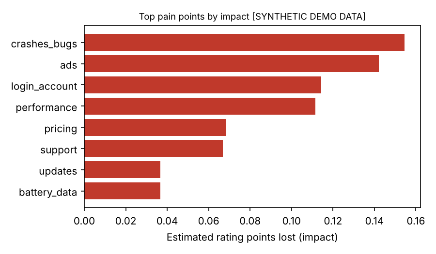

# ReviewLens: from app reviews to a prioritised product recommendation

> **Interactive case study:** https://sabarish-r.github.io/app-review-insights/ (served from `docs/index.html`; enable GitHub Pages → main → /docs)

A small analytics tool plus a case-study template. It takes a CSV of app reviews (text, star rating, date), tags each review with product themes (crashes, ads, pricing, login, and so on), and ranks the themes by **how many rating points they cost the product**. It then produces charts and CSVs you can load into Power BI or Tableau.

The point is not the code. It is the workflow a product manager follows: define the question, measure, rank by impact, recommend one thing, and say how you would test it.

## What it produces

For any reviews file you give it:

- `reports/report.md`: dataset summary, rating distribution, ranked pain-point table
- `reports/theme_metrics.csv` and `reports/monthly_trends.csv`: ready for Power BI or Tableau
- Charts: rating distribution, top pain points by impact, monthly average rating

## Sample output

Generated from **synthetic demo reviews** (not real findings), so you can see the format:



See [`docs/demo/report.md`](docs/demo/report.md) for the full sample report.

## Quick start

```bash
git clone https://github.com/SABARISH-R/app-review-insights.git
cd app-review-insights
pip install -r requirements.txt

# put your CSV in data/ (git-ignored), then run with your own column names:
PYTHONPATH=src python -m reviewlens --input data/reviews.csv \
    --text-col content --rating-col score --date-col at --out reports
```

Required columns: review text and a 1-5 star rating. A date column is optional (it enables the trend chart).

## Test

```bash
PYTHONPATH=src python -m unittest discover -s tests -v
```

The tests check cleaning, theme matching and the impact formula against hand calculations.

## How pain points are ranked

`impact = share of reviews mentioning the theme x (overall average rating - average rating of reviews mentioning it)`

It estimates how many rating points the average review loses because of that theme, so it favours problems that are both common and painful. Full definitions and limitations are in [`docs/METHODOLOGY.md`](docs/METHODOLOGY.md).

## The case study

[`docs/RECOMMENDATION_TEMPLATE.md`](docs/RECOMMENDATION_TEMPLATE.md) is a one-page structure for turning the output into a recommendation with a success metric, guardrail metric and experiment design.

## Status

- [x] Cleaning, theme tagging, impact scoring, charts, tests
- [ ] Run on a real single-product review dataset and write up the findings in `docs/RECOMMENDATION.md`
- [ ] Validate theme tags against a hand-labelled sample of 100 reviews and report precision
- [ ] Add sentiment so praise ("love the design") is separated from complaints

## Limitations

Theme tagging is keyword-based, so it misses paraphrases and cannot tell praise from complaint. The rating gap handles part of this, but a theme with a positive gap should not be read as a problem. Reviews are a self-selected sample and do not represent all users. See the methodology for more.

## License

MIT

## Results
See [RESULTS.md](RESULTS.md).
