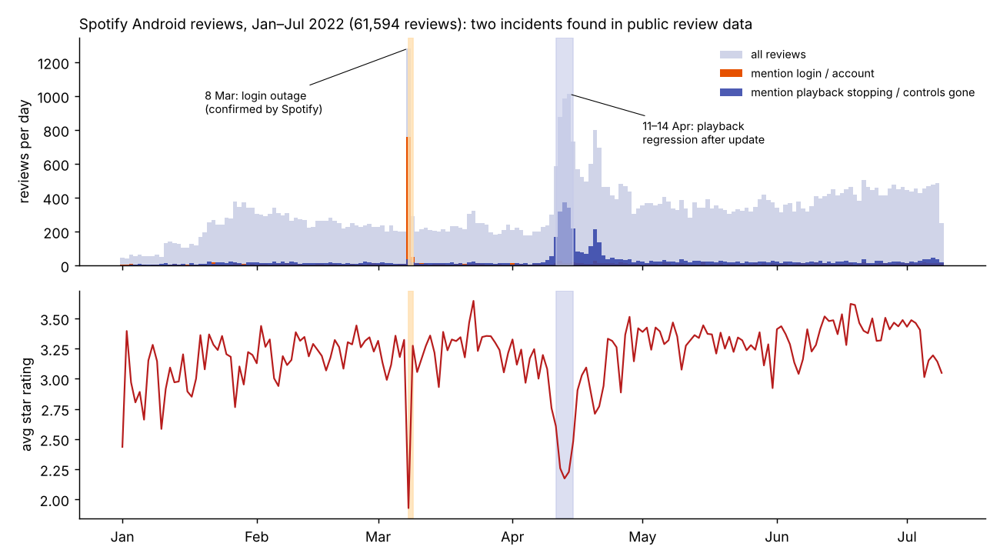
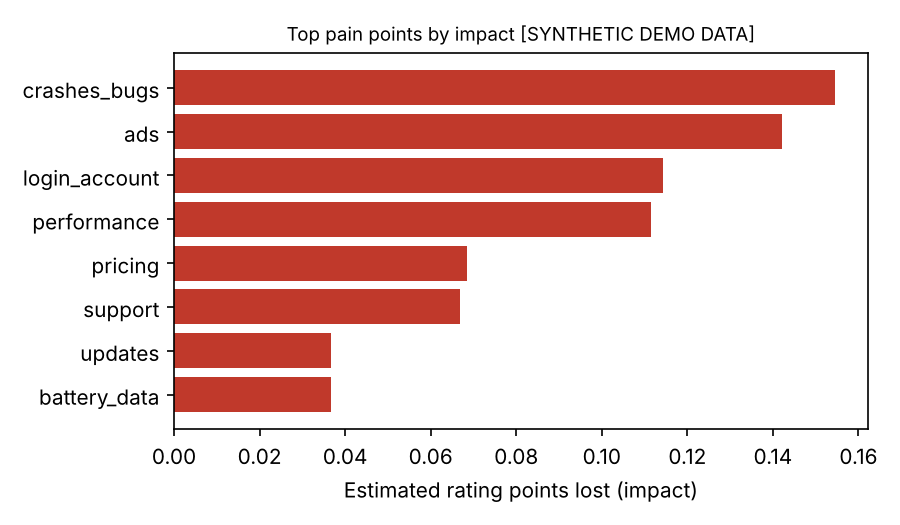
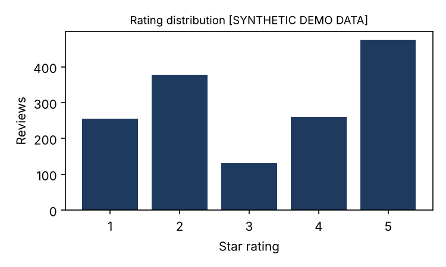

# Results

Produced on 2026-11-16 with Python 3.12.3.

## Unit tests
`PYTHONPATH=src python -m unittest discover -s tests`

```
----------------------------------------------------------------------
Ran 6 tests in 0.045s

OK
```

The tests verify data cleaning counts, theme matching (including word-boundary handling) and the impact formula against hand calculations.

## Findings on real data: Spotify Android, Jan–Jul 2022
61,594 Google Play reviews (source and download: `data/real/README.md`). Full write-up: [`reports/spotify_2022/FINDINGS.md`](reports/spotify_2022/FINDINGS.md).

Top three by impact: crashes/bugs 0.132, playback stopping 0.106, bad updates 0.102. Pricing (15.2% of reviews) and ads (12.4%) are mentioned more but cost less.

A spike rule (over 2x the 14-day review volume and 0.5 stars below the 14-day rating) fired on 5 days in six months: 8 March (login outage, confirmed by Spotify's incident report) and 11–14 April (playback regression).



Tag precision: not measured yet. Label `reports/spotify_2022/precision_check_100.csv` and report it here.

## Sample output (synthetic demo data)
The charts below come from **generated** reviews and show only what the tool produces. They are **not findings**. Regenerate with `PYTHONPATH=src python scripts/make_demo.py`. Open `docs/demo/report.md` for the full sample report and the CSVs you can load into Power BI or Tableau.




