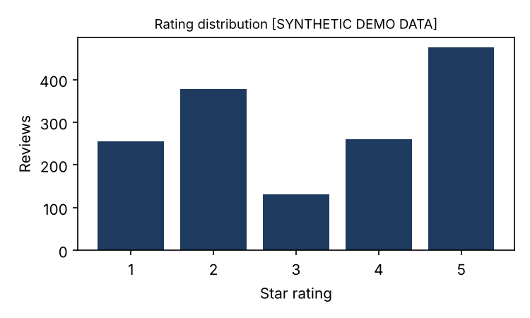
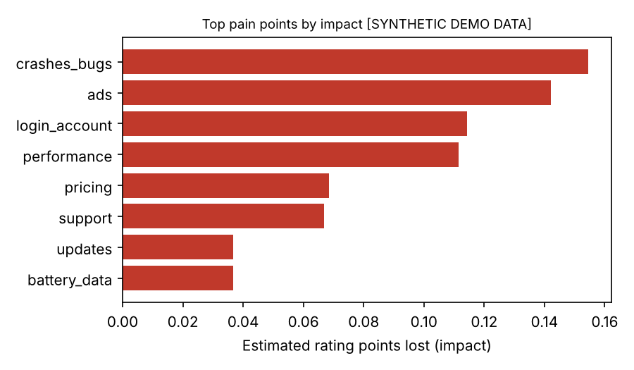
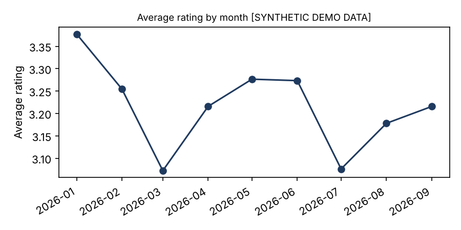

> **SYNTHETIC DEMO DATA. These are generated reviews used to show the output format. They are not real findings.**

# Review analysis report

_Generated by ReviewLens. Read docs/METHODOLOGY.md for definitions and limitations._

## Dataset
- Rows in file: 1500
- Rows analysed: 1500
- Dropped: 0 missing text/rating, 0 invalid rating, 0 duplicates
- Average rating: 3.21
- Share of 1-2 star reviews: 42.3%

## Pain points (themes with at least 30 mentions are marked reliable)

| theme | mentions | share_of_reviews | share_of_low_rated | avg_rating_when_mentioned | rating_gap | impact | reliable |
|---|---|---|---|---|---|---|---|
| crashes_bugs | 125 | 8.3% | 19.7% | 1.36 | 1.853 | 0.154 | True |
| ads | 137 | 9.1% | 21.6% | 1.657 | 1.556 | 0.142 | True |
| login_account | 92 | 6.1% | 14.5% | 1.348 | 1.866 | 0.114 | True |
| performance | 133 | 8.9% | 16.7% | 1.955 | 1.258 | 0.112 | True |
| pricing | 112 | 7.5% | 12.5% | 2.295 | 0.919 | 0.069 | True |
| support | 53 | 3.5% | 8.4% | 1.321 | 1.893 | 0.067 | True |
| updates | 61 | 4.1% | 6.6% | 2.311 | 0.902 | 0.037 | True |
| battery_data | 61 | 4.1% | 6.6% | 2.311 | 0.902 | 0.037 | True |
| missing_features | 89 | 5.9% | 0.0% | 3.416 | -0.202 | -0.012 | True |
| ui_ux | 233 | 15.5% | 0.0% | 4.67 | -1.456 | -0.226 | True |

## Trend

