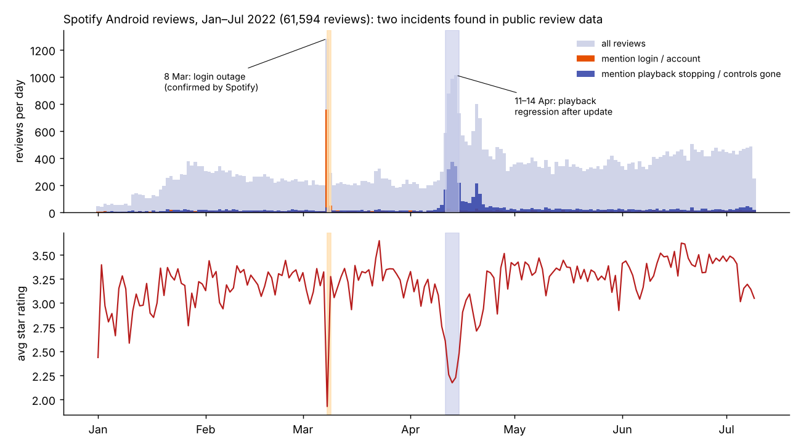

# Spotify Android reviews, Jan–Jul 2022: what costs the most stars

Data: 61,594 Google Play reviews of Spotify, 1 Jan to 9 Jul 2022 (see `data/real/README.md`).
Run: `PYTHONPATH=src python -m reviewlens.cli --input data/real/spotify_reviews_2022.csv --text-col Review --rating-col Rating --date-col Time_submitted --out reports/spotify_2022`

Average rating 3.16. 40.2% of reviews are 1–2 stars.

## Top pain points by impact

| Theme | Share of reviews | Avg rating when mentioned | Impact (rating points lost) |
|---|---|---|---|
| Crashes / bugs | 12.1% | 2.06 | 0.132 |
| Playback stopping, controls disappearing | 8.7% | 1.94 | 0.106 |
| Updates ("since the latest update…") | 9.7% | 2.10 | 0.102 |
| Pricing / premium | 15.2% | 2.74 | 0.064 |
| Ads | 12.4% | 2.79 | 0.045 |

Pricing and ads come up more often than anything else, but people who mention them still rate about 2.7–2.8. Reliability (crashes, playback, bad updates) is where the stars go.

Full table: `report.md`, `theme_metrics.csv`.

## The April 2022 incident

- From 11 to 15 April 2022, reviews went from about 207 a day to 839 a day (4x).
- The average rating in those days was 2.32, against 3.16 in the two weeks before. 64% of reviews were 1–2 stars, up from 39%.
- 34% of reviews in the spike describe playback pausing by itself, songs stopping, or the now-playing bar and play button disappearing. The baseline is 7%.
- Typical wording: "malfunctioning since the latest update", "no play button", "Android 12".
- A second, smaller wave on 19–21 April suggests the first fix did not fully work.
- Ratings were back to around 3.3 by late April.

My first theme list did not have a playback theme, so the tool scored this incident as generic "crashes". I added a `playback` theme after reading the spike reviews. The keyword list is only as good as the person reading the reviews.

## Backtest: would a simple alert have caught these?

Rule: alert when a day has more than 2x the reviews of the previous 14-day average **and** an average rating 0.5 stars below it.

Over Jan–Jul 2022 the rule fired on 5 days and nothing else:

| Day | Reviews | Avg rating | What it was |
|---|---|---|---|
| 8 Mar 2022 | 1,282 (vs ~225/day) | 1.93 | Login outage. 62% of that day's reviews mention logging in; 795 reviews arrived in the 18:00 UTC hour alone. Spotify's own incident report confirms a global outage that day: users who were logged out could not log back in, with reports starting at 18:12 UTC ([Spotify Engineering](https://engineering.atspotify.com/2022/3/incident-report-spotify-outage-on-march-8)). |
| 11–14 Apr 2022 | 588–1,013 | 2.17–2.61 | The playback regression above. Flagged on day one. |

Zero false alarms in about six months, and both real incidents were caught on the day they started. I picked the thresholds by hand after seeing the April spike. The 8 March outage was then found by the rule, not something I went looking for. Six months is a short window, so the false-alarm rate needs a longer backtest.

## Recommendation

1. **Alert on review spikes.** The rule above caught a confirmed backend outage on the day it happened and a client regression on its first day. An hourly version would catch the outage within the hour. Review data is free and public.
2. **Gate releases on playback health.** Track "unexpected pause" and "player UI missing" events per session in staged rollouts, and halt the rollout when they rise above baseline.
3. **How to test it:** roll out the spike alert to the on-call channel for one quarter. Success = time from release to detecting a regression (target: under 24 hours), with fewer than 1 false alarm a week.

## Limits

- Keyword tagging. Precision has not been measured yet: `precision_check_100.csv` has 100 tagged reviews to label by hand.
- Impact is correlation. It shows which complaints come with low ratings, not that fixing them raises the rating.
- Google Play only, English only, and Play Store shows the most-recent and most-relevant reviews, not a random sample.
