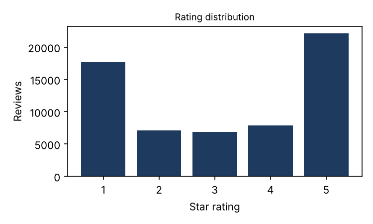
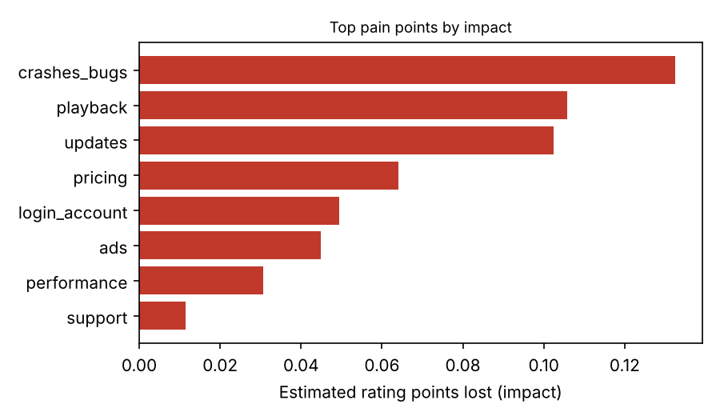
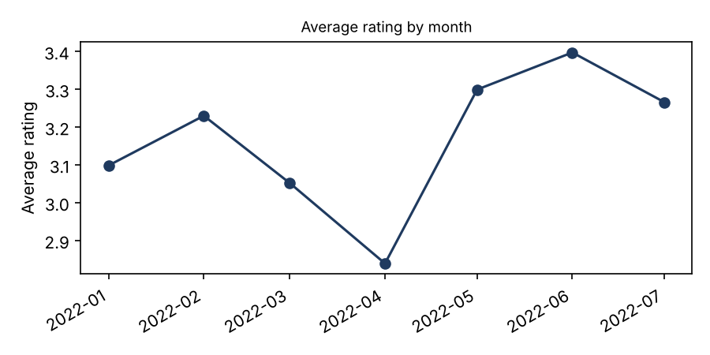

# Review analysis report

_Generated by ReviewLens. Read docs/METHODOLOGY.md for definitions and limitations._

## Dataset
- Rows in file: 61594
- Rows analysed: 61594
- Dropped: 0 missing text/rating, 0 invalid rating, 0 duplicates
- Average rating: 3.16
- Share of 1-2 star reviews: 40.2%

## Pain points (themes with at least 30 mentions are marked reliable)

| theme | mentions | share_of_reviews | share_of_low_rated | avg_rating_when_mentioned | rating_gap | impact | reliable |
|---|---|---|---|---|---|---|---|
| crashes_bugs | 7466 | 12.1% | 20.7% | 2.063 | 1.093 | 0.132 | True |
| playback | 5363 | 8.7% | 15.7% | 1.942 | 1.214 | 0.106 | True |
| updates | 5981 | 9.7% | 16.5% | 2.1 | 1.056 | 0.102 | True |
| pricing | 9392 | 15.2% | 19.4% | 2.736 | 0.42 | 0.064 | True |
| login_account | 2572 | 4.2% | 7.5% | 1.974 | 1.182 | 0.049 | True |
| ads | 7643 | 12.4% | 14.6% | 2.794 | 0.362 | 0.045 | True |
| performance | 2043 | 3.3% | 5.2% | 2.229 | 0.927 | 0.031 | True |
| support | 1081 | 1.8% | 2.6% | 2.506 | 0.65 | 0.011 | True |
| notifications | 639 | 1.0% | 1.7% | 2.149 | 1.007 | 0.01 | True |
| ui_ux | 2048 | 3.3% | 3.8% | 2.889 | 0.267 | 0.009 | True |
| missing_features | 3860 | 6.3% | 6.0% | 3.066 | 0.09 | 0.006 | True |
| battery_data | 403 | 0.7% | 0.9% | 2.633 | 0.523 | 0.003 | True |

## Trend

